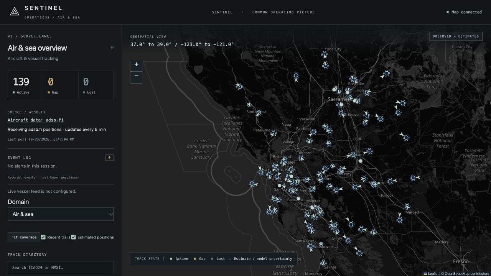
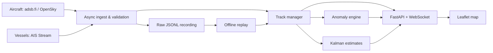

# Sentinel

### Live aircraft tracking, maritime replay, and anomaly detection

[](https://github.com/zxcv616/Sentinel/actions/workflows/tests.yml)


**[Open live map →](https://sentinel-live-2nt0.onrender.com/)** · **[Explore recorded scenarios →](https://sentinel-airspace.mwieckin.workers.dev/)** · [Architecture](docs/architecture.md) · [Run locally](docs/development.md)

Sentinel turns ADS-B aircraft reports and AIS vessel messages into a common
operating picture: tracked objects, recent trails, position estimates, and an
event log. It combines resilient asynchronous ingestion with deterministic replay
so tracking and alert behavior can be reproduced from the original inputs.


*Live deployment captured October 23, 2026. Aircraft counts vary; this is a screenshot, not a capacity benchmark.*

> **Try it in a minute:** Open the live map, select an aircraft, and inspect its
> trail and position details. For a repeatable alert demonstration, open the
> recorded demo and use the synthetic air & sea scenario. Render may need about
> a minute to wake after inactivity.

## What it does

| Capability | Implementation |
| --- | --- |
| Resilient ingestion | Async HTTP polling and AIS WebSockets; retry backoff, rate-limit handling, validation, and source-health reporting. |
| Track management | Source-qualified ICAO24/MMSI identities, bounded histories, duplicate/out-of-order rejection, and active → gap → lost aging. |
| Anomaly detection | Aircraft signal gaps and emergency squawks; vessel loitering. Source-health checks, airport filtering, and deduplication reduce misleading alerts. |
| Position estimation | Horizontal constant-velocity Kalman filter with a 60-second prediction limit; observed and estimated positions remain visually distinct. |
| Reproducible processing | Original provider payloads, configuration, airport references, and clock events recorded to JSONL and replayed offline. |
| Live interface | FastAPI REST endpoints and shared WebSocket snapshots feeding a Leaflet map with search, trails, domain filters, and alert details. |

## Engineering evidence

- **110 Python tests + 11 JavaScript tests** at the documented validation snapshot, covering ingestion, alerts, tracking, replay, and cross-runtime parity. [Test workflow](.github/workflows/tests.yml)
- **248 aircraft and 6,423 observations** in the recorded tracking evaluation dataset—not a load-test result. [Method and results](docs/validation.md)
- **Exact replay comparisons** include track histories and alert IDs/timestamps; synthetic scenarios exercise outages, recovery, deduplication, and loitering. [Fixture provenance](tests/fixtures/README.md)
- **One shared collector** serves all viewers. Opening additional browser connections does not create additional aircraft polls. [Server implementation](src/sentinel/web.py)

The Kalman model is evaluated against a reported-velocity baseline. The baseline
performed better on the recorded dataset; the project documents that result
instead of claiming an unmeasured accuracy improvement.

## Architecture



Track state is currently in memory. Raw inputs and alerts are local JSONL files;
PostgreSQL is planned, not implemented. The Cloudflare replay site serves
precomputed frames and does not collect live data. [Read the design decisions →](docs/architecture.md)

## Deployment status

| | Live site · Render | Recorded demo · Cloudflare |
| --- | --- | --- |
| Aircraft | Live adsb.fi data covering the Bay Area | Captured OpenSky reports and labeled synthetic scenarios |
| Vessels | Adapter implemented; public feed not enabled | Synthetic vessel tracks and loitering walkthrough |
| Updates | One shared aircraft poll every **5 minutes** | Browser playback with pause, restart, and scenario selection |
| Storage | Temporary tracks/logs; reset on restart | Bundled replay fixtures |

Live AIS requires a server-side key and has not been verified against the provider.
The five-minute aircraft cadence is a hosting tradeoff: short-term predictions
stop after 60 seconds and do not fill the entire polling interval. This is a
portfolio demonstration, not a navigation or operational decision system.

## Run and test

Python 3.11+ and Node.js 22+ are needed for the full test suite. From the repository root:

```sh
python3 -m venv .venv
source .venv/bin/activate
python -m pip install -e '.[dev]'

# Reproduce alerts offline—no API credentials or network requests.
sentinel --replay tests/fixtures/scenario.jsonl

# Run Python tests and JavaScript parity/replay tests.
python -m pytest -q
npm --prefix cloudflare ci
npm --prefix cloudflare test
```

To run the same aircraft source and cadence as the hosted site:

```sh
SENTINEL_MODE=live SENTINEL_AIRCRAFT_SOURCE=adsbfi \
  python -m uvicorn sentinel.hosting:create_hosted_app --factory \
  --host 127.0.0.1 --port 8000 --workers 1
```

Open [localhost:8000](http://127.0.0.1:8000). Provider access is subject to its terms
and availability. [Configuration, OpenSky, AIS, and replay commands →](docs/development.md)

## Explore the code

| Area | Start here |
| --- | --- |
| Providers and resilience | [adsbfi.py](src/sentinel/adsbfi.py), [opensky.py](src/sentinel/opensky.py), [ais.py](src/sentinel/ais.py) |
| Tracking and estimation | [tracks.py](src/sentinel/tracks.py), [estimation.py](src/sentinel/estimation.py) |
| Detection rules | [alerts.py](src/sentinel/alerts.py), [maritime.py](src/sentinel/maritime.py) |
| Recording and replay | [pipeline.py](src/sentinel/pipeline.py), [replay.py](src/sentinel/replay.py) |
| API and map | [web.py](src/sentinel/web.py), [frontend](src/sentinel/static/) |
| Tests and evidence | [tests](tests/), [JavaScript tests](cloudflare/test/), [evaluation](docs/validation.md) |

**Stack:** Python · asyncio · httpx · FastAPI · WebSockets · JavaScript · Leaflet · pytest · JSONL · Render · Cloudflare Workers

## Documentation and next steps

[Development guide](docs/development.md) · [Deployment guide](docs/deployment.md) · [Pipeline reference](docs/reference.md) · [Validation](docs/validation.md) · [Contributing](CONTRIBUTING.md)

Next priorities are live AIS validation, durable storage and log retention,
separate tuning/evaluation recordings for the estimator, and speed/altitude-jump
detection. Multi-source correlation is future work.

## Data attribution

Aircraft: [adsb.fi](https://adsb.fi/) and [OpenSky Network](https://opensky-network.org/).
Vessel integration: [AIS Stream](https://aisstream.io/).
Airport reference: [OurAirports](https://ourairports.com/data/).
Map data: [OpenStreetMap contributors](https://www.openstreetmap.org/copyright).
Recorded fixture provenance is documented [here](tests/fixtures/README.md).
Provider data remains subject to its respective terms; synthetic scenarios are explicitly labeled.
